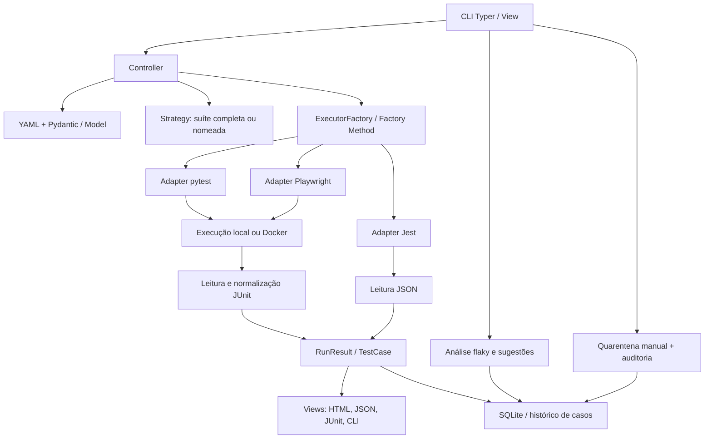

# Arquitetura e decisões

## Fluxo e camadas

`models.py` concentra o domínio, sem apresentação. `cli.py` recebe comandos e apresenta resumos. `controller.py` coordena a aplicação, sem lógica específica de pytest, Playwright ou Jest. Os módulos de infraestrutura executam processos, interpretam JUnit, renderizam relatórios e persistem o histórico. Essa divisão aplica o Controller e baixo acoplamento do GRASP e uma separação inspirada em MVC.

## Padrões pedidos no PDF

| Padrão | Implementação | Motivo |
|---|---|---|
| Factory Method | `ExecutorFactory.create_adapter`, especializado pelas fábricas pytest, Playwright e Jest | Criar a implementação concreta atrás de um contrato comum |
| Adapter | `PytestAdapter`, `PlaywrightAdapter` e `JestAdapter` | Traduzir configuração comum em argumentos e ambiente da ferramenta |
| Strategy | `FullSuite` e `NamedSuite` | Substituir a estratégia de seleção; `quick` é uma suíte nomeada explícita |
| GRASP Controller | `run_project` | Coordenar configuração, execução e saída |
| MVC adaptado | modelos Pydantic, CLI/templates e controlador | Separar domínio, apresentação e coordenação |

## Decisões

1. **Sem LLM:** a seleção é explícita e reproduzível. Descobrir regras de negócio e gerar testes foi descartado porque não faz parte do agente definido pela equipe.
2. **JUnit e JSON como formatos de entrada:** pytest e Playwright emitem JUnit; Jest emite JSON. Os adaptadores normalizam ambos para `TestCase`, evitando análise frágil do texto do terminal. Os artefatos originais são preservados.
3. **Processos sem shell:** argumentos são listas e Playwright e Jest usam os CLIs locais do projeto. Comandos shell configuráveis foram descartados para reduzir problemas de quoting e execução acidental de metacaracteres.
4. **Pastas únicas por execução:** evita usar resultados antigos e permite execuções simultâneas. Não existe um arquivo global de resultado sobrescrito a cada execução.
5. **JSON e SQLite:** JSON é o contrato de intercâmbio futuro; SQLite permite histórico sem serviço externo. Falha no SQLite é informada nos relatórios, mantendo o resultado dos testes.
6. **Preparação explícita:** instalar dependências automaticamente foi descartado para não alterar ambientes de terceiros durante testes. O usuário prepara o ambiente Python/Node ou uma imagem Docker e o agente executa nesse ambiente.

## Limites conhecidos

- Suítes com apenas testes ignorados são `passed`, mas os contadores mostram que nenhum teste foi aprovado.
- A análise de testes intermitentes usa os resultados por caso já registrados no SQLite; `qualitybridge flaky` informa métricas e recomendação de quarentena, sem desabilitar testes automaticamente.
- O contexto seguro de execução acompanha cada resultado: plataforma, versões detectáveis de runtimes, opções Docker, timeout e nomes das variáveis configuradas. Valores de ambiente não são persistidos.
- Em Docker, versões internas do container não são inferidas; a imagem configurada identifica o ambiente. Históricos anteriores são compatíveis e ficam sem contexto detalhado.
- A quarentena é uma decisão explícita, reversível e auditada; não altera a seleção nem interrompe a coleta dos testes.
- Sugestões de correção são heurísticas locais baseadas em mensagens e stack traces, sempre acompanhadas de evidências e confiança; não modificam arquivos.
- Cobertura de código, criação de testes, interface gráfica e orquestração entre agentes não fazem parte do escopo.
- O comando, mensagens de teste e logs podem conter dados do projeto; revise antes de compartilhar.
- Docker é opcional e exige daemon local. As imagens não são construídas automaticamente pelo agente.
- A preparação de servidores, bancos e dados de teste pertence às fixtures/configurações do projeto; o agente herda o ambiente e permite variáveis adicionais pelo YAML.
