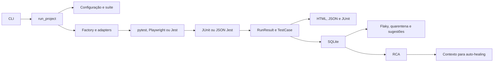

# Entrega das atividades 1 e 6

Este documento reúne as evidências de implementação encontradas no
QualityBridge para as responsabilidades de **Arquitetura e integração geral**
(integrante 1) e **Testes, relatórios e documentação** (integrante 6), conforme
o plano de divisão de atividades.

## Atividade 1 — Arquitetura e integração geral

### Fluxo principal

`run_project` em `src/qualitybridge/controller.py` coordena configuração,
estratégia de suíte, factory/adapters, processo, normalização do resultado,
relatórios e persistência. A CLI chama essa mesma camada para as execuções
normais e as reexecuções usadas na análise flaky. Os contratos compartilhados
`RunResult`, `TestCase` e `ExecutionContext` ficam em `models.py`; isso permite
que módulos posteriores consumam o resultado sem depender do formato de cada
runner.

| Responsabilidade | Implementação | Evidência no repositório |
|---|---|---|
| Entrada e coordenação | Typer e `run_project` | `src/qualitybridge/cli.py`, `controller.py` |
| Contrato comum | `RunResult`, `TestCase`, `ExecutionContext` | `src/qualitybridge/models.py` |
| Seleção de suíte | Factory e estratégias `FullSuite` / `NamedSuite` | `adapters.py`, `strategies.py` |
| Frameworks | pytest, Playwright e Jest | `adapters.py`, `jest.py`, `junit.py` |
| Relatórios e histórico | HTML, JSON, JUnit XML e SQLite | `reports.py`, `templates/report.html`, `history.py` |
| Integração dos módulos | flaky, RCA, sugestões e auto-healing | `flaky.py`, `rca.py`, `suggestions.py`, `auto_healing.py` |

As decisões, os padrões Adapter, Strategy, Factory Method, Controller e a
separação de camadas estão detalhados em [`architecture.md`](architecture.md).
Os testes `test_execution.py` e `test_controller.py` cobrem o fluxo entre
execução, histórico e artefatos; `test_rca.py` verifica a passagem das
evidências para o contexto do auto-healing.

**Situação encontrada:** arquitetura e integração geral já estavam
implementadas na `main`; não foi necessário alterar lógica de produção para
essa atividade. Este mapa consolida as interfaces e aponta as evidências para
revisão e apresentação.

## Atividade 6 — Validação, evidências e documentação

### Materiais existentes

- Suite automatizada em `tests/`, incluindo fluxos de integração e testes de
  fallback e erro.
- Roteiro de aceitação e demonstração em [`acceptance.md`](acceptance.md).
- Cenários conhecidos do RCA em `examples/rca-scenarios/scenarios.json` e
  métrica reprodutível via `python scripts/validate_rca.py`.
- Demonstrações ponta a ponta em `scripts/demo.py` e
  `examples/rca-demo.py`.
- Relatório de validação e estado de reprodução em
  [`validation.md`](validation.md).

### Estado da evidência nesta revisão

A revisão de 2026-11-13 executou os 94 testes (94 aprovados em 6,71 s, com Git disponível), o Ruff, os 12 cenários RCA (100% em categoria, commit e evidência; média 0,12 ms),
ambas as suítes pytest, ambas as suítes Playwright no Chromium e a demonstração
flaky de quatro reexecuções. A imagem Docker `qualitybridge:local` foi construída
e a suíte quick passou com 19/19 testes em `20261113T204511-eb0abba2bb7b`.
Os artefatos Docker estão em `.qualitybridge/runs/20261113T204511-eb0abba2bb7b/`.
Duas capturas PNG foram conferidas visualmente em `docs/evidence/`; a revisão
corrigiu a codificação do template HTML.

### Próximos passos para fechar a coleta empírica

1. Repetir os comandos de `validation.md` em outra máquina e comparar os
   resultados com o registro desta execução.
2. Em uma nova máquina, repetir a validação Docker e registrar o ID da execução
   e seus artefatos.
## Roteiro de apresentação

Use [`presentation.md`](presentation.md) como sequência de slides e fala.
Comece pela necessidade de normalizar resultados de diferentes runners,
mostre o fluxo integrado, demonstre os relatórios e finalize com RCA/flaky e
as limitações da validação disponível.

