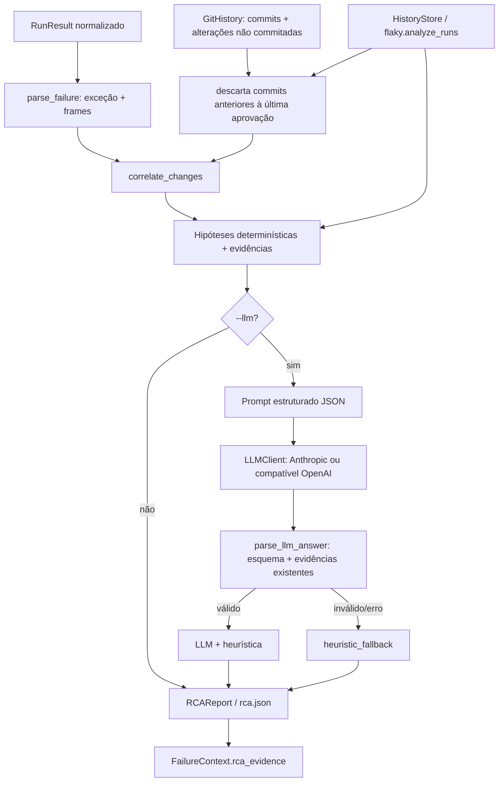

# Análise de causa raiz (RCA)

Responsável: Integrante 3 — Inteligência artificial e RCA.

## Objetivo

Investigar as causas prováveis de cada teste reprovado e entregar um
diagnóstico **fundamentado**: toda hipótese cita evidências identificadas
(`E1`, `E2`...) extraídas da falha, do stack trace, do Git ou do histórico. O
módulo não altera arquivos; correções ficam com o Auto-healing.

## Arquitetura



| Arquivo | Responsabilidade |
|---|---|
| `rca.py` | Modelos, parsing de stack traces, leitura do Git, correlação, heurística e `RootCauseAnalyzer` |
| `rca_prompts.py` | Categorias, prompt de sistema, montagem do contexto e mascaramento de segredos |
| `llm.py` | Contrato `LLMClient` e clientes Anthropic e compatível com OpenAI (biblioteca padrão) |
| `rca_validation.py` | Execução e métricas dos cenários conhecidos |
| `examples/rca-scenarios/scenarios.json` | 12 cenários com causa esperada |
| `scripts/validate_rca.py` | Relatório de validação dos cenários |
| `examples/rca-demo.py` | Demonstração ponta a ponta com Git real |

Padrões: `LLMClient` e `ChangeSource` são *Protocols* (Strategy) — o analisador
não conhece o provedor nem a origem das alterações, o que permite usar
`StaticChanges` e dublês de LLM nos testes.

## 1. Análise de stack traces e mensagens

`parse_failure` reconhece:

- traceback Python (`File "x.py", line 10, in f`);
- formato longo do pytest (`src/calc.py:2: ZeroDivisionError` e a função `def`
  do bloco);
- frames de Jest/Node e Playwright (`at Classe.metodo (src/a.js:31:12)`).

Cada frame é marcado como **biblioteca** (`site-packages`, `node_modules`...)
ou **código de teste**. O tipo da exceção vem da linha final do pytest, das
linhas `E   Erro:` ou do início da mensagem. Símbolos citados (`divide(4, 2)` na
mensagem ou na linha `>` que falhou) também são extraídos.

## 2. Relação com alterações recentes do Git

`GitHistory` executa `git` sem shell, com timeout, usando `--relative` para que
os caminhos fiquem relativos à raiz do projeto. Considera os últimos N commits
(`--commits`, padrão 10) e as alterações não commitadas (`WORKTREE`).

Força do vínculo, da mais forte para a mais fraca:

1. `linha_alterada` — o hunk do diff cobre a linha do frame da aplicação;
2. `arquivo_do_stack` — o arquivo alterado aparece no stack trace;
3. `simbolo_alterado` — um trecho alterado contém a função citada na falha;
4. `arquivo_do_teste` — só o próprio teste mudou.

Commits **anteriores à última execução aprovada** do teste são descartados (com
tolerância de 60 s): se o teste passou depois deles, eles não explicam a falha.
Arquivos de teste não relacionados e documentação não geram vínculo.

## 3. Hipóteses, evidências e sugestões

A heurística classifica a falha em uma das categorias de `rca_prompts.CATEGORIES`
(asserção, contrato de API, dados inválidos, seletor, tempo, dependência
externa, ambiente, intermitência, regressão, teste desatualizado, não
classificada). Regras de confiança:

| Situação | Confiança |
|---|---:|
| Categoria pelo tipo da exceção | 0,50 |
| Categoria só por palavra-chave | 0,40 |
| Sem classificação | 0,20 |
| Regressão ligada a commit | 0,55 (+0,15 linha alterada, +0,10 se passava antes; máx. 0,90) |
| Teste desatualizado (alternativa à regressão) | regressão − 0,20 (mín. 0,30) |
| Intermitência no histórico | 0,70 (0,55 se também há commit relacionado) |

Quando há um commit relacionado e a falha é de asserção, contrato ou seletor,
o RCA apresenta **duas** hipóteses: regressão da aplicação e teste
desatualizado. Decidir entre elas exige saber a intenção da mudança; o RCA não
finge essa certeza.

## 4. Integração com LLM

O LLM é opcional e só é usado com `--llm`. Configuração por ambiente:

```powershell
# Anthropic
$env:ANTHROPIC_API_KEY = "..."
$env:QUALITYBRIDGE_LLM_MODEL = "claude-haiku-5-5"   # opcional

# Qualquer API compatível com OpenAI (OpenAI, Groq, Gemini, Ollama local...)
$env:QUALITYBRIDGE_LLM_PROVIDER = "openai"
$env:QUALITYBRIDGE_LLM_BASE_URL = "http://localhost:11434/v1"   # Ollama
$env:QUALITYBRIDGE_LLM_MODEL = "llama3.1"
$env:QUALITYBRIDGE_LLM_API_KEY = "..."   # se o provedor exigir
```

### Prompt estruturado

- **Sistema** (`SYSTEM_PROMPT`): papel, regras (usar só evidências, citar IDs,
  diferenciar defeito de teste desatualizado, confiança máxima 0,9), lista de
  categorias e formato JSON obrigatório.
- **Usuário** (`build_user_prompt`): JSON determinístico com o teste, as
  evidências numeradas, stack trace e diffs relacionados, e as pistas da
  heurística, dentro de `<contexto_da_falha>`.

### Salvaguardas

- Conteúdo do projeto (mensagens, logs, diffs) é declarado como **dado**, não
  instrução, para reduzir *prompt injection* vindo do código analisado.
- Valores após `token=`, `password:`, `api_key=` etc. são mascarados antes do envio.
- `parse_llm_answer` valida o esquema, descarta IDs de evidência inexistentes e
  hipóteses sem evidência, troca categorias desconhecidas por
  `nao_classificada` e limita a confiança a 0,9.
- Erro de rede, JSON inválido ou nenhuma hipótese fundamentada ⇒
  `engine = heuristic_fallback`, com o motivo em `warnings`.
- `--max-llm-cases` (padrão 10) limita custo em execuções com muitas falhas.

Atenção: com `--llm`, trechos de código, diffs e mensagens dos testes são
enviados ao provedor configurado. Use apenas em projetos em que isso é
permitido; o Ollama local evita o envio externo.

## 5. Uso

```powershell
qualitybridge run
qualitybridge rca                    # última execução com falhas
qualitybridge rca --run <ID> --commits 20
qualitybridge rca --llm
qualitybridge rca --commits 0        # sem Git
```

A saída JSON também é gravada em `.qualitybridge/runs/<ID>/rca.json`. O resumo
da hipótese principal de cada teste vai para o stderr.

Uso programático (para o orquestrador e o Auto-healing):

```python
from qualitybridge.rca import GitHistory, RootCauseAnalyzer

report = RootCauseAnalyzer(GitHistory(root), history=runs).analyze(result)
evidencias = report.evidence_by_case()  # {(classname, nome): [str, ...]}
FailureContext(case=caso, rca_evidence=evidencias[(caso.classname, caso.name)], ...)
```

## 6. Validação com cenários conhecidos

```powershell
python scripts/validate_rca.py              # sem rede
python scripts/validate_rca.py --llm --json rca-llm.json
python examples/rca-demo.py                 # Git real, regressão introduzida por commit
```

Métricas: acerto da categoria principal, acerto do commit apontado (inclusive
"nenhum" quando não deve haver vínculo), proporção de diagnósticos com todas as
hipóteses fundamentadas e tempo médio. Resultado atual da heurística: 12/12 em
categoria e commit, 100% fundamentado, menos de 1 ms por caso.

Os cenários cobrem regressão por linha, por símbolo e por alteração não
commitada, commit antigo que deve ser ignorado, falso vínculo com documentação,
contrato de API, ambiente, serviço externo, seletor Playwright, asserção Jest,
intermitência, teste alterado e falha sem evidência.

## Limitações

- Os cenários foram escritos junto com a heurística; 100% neles mostra
  coerência com os casos previstos, não precisão em projetos reais. Para o
  relatório final, convém medir também falhas reais de outros projetos.
- Sem histórico, o RCA não sabe se o teste passava antes e não filtra commits por data.
- Vínculo por símbolo depende do nome aparecer no trecho do diff; mudanças
  indiretas (configuração, dependência transitiva) podem passar despercebidas.
- A qualidade do modo LLM depende do modelo escolhido; ele é sempre validado e
  complementado pela heurística, nunca a substitui.
