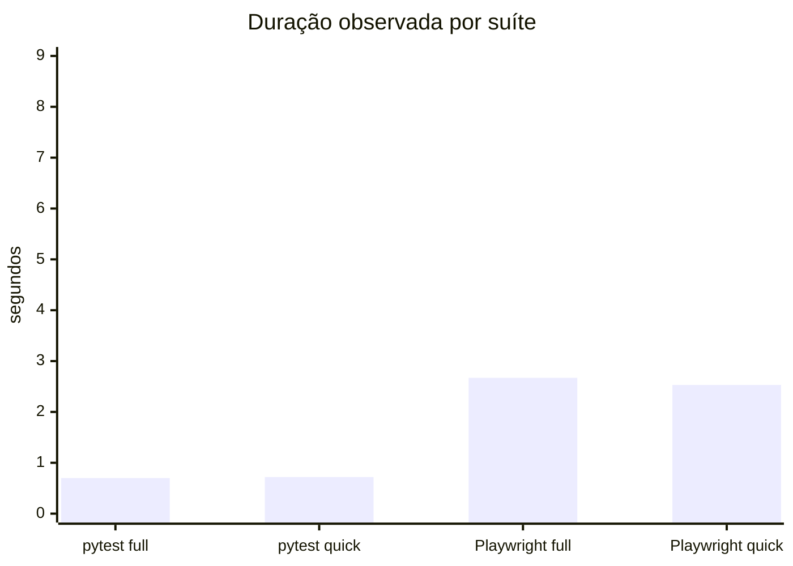

# Validação e evidências

## Registro reproduzido nesta revisão

**Executado em 2026-11-13** em Windows 11, CPython 3.12.16, pytest 9.1.1,
Node.js 22 e Chromium 153.0.8010.12. Python, dependências e Chromium foram
preparados em pastas temporárias; o repositório não recebeu ambiente virtual
nem dependências versionadas.

| Verificação | Resultado observado |
|---|---|
| Testes do agente (`pytest -q`) | **94 aprovados**, 6,71 s (container Python 3.12.16 com Git 2.47.3) |
| Ruff (`ruff check src tests`) | **Sem apontamentos** |
| Cenários RCA determinísticos | **12/12** em categoria, commit e evidência; média de **0,12 ms/caso** |
| Exemplo pytest completo | **4 aprovados, 1 ignorado** — execução `20261113T203530-d5c5f92ee999` |
| Exemplo pytest rápido | **1 aprovado** — execução `20261113T203533-af5902f6df66` |
| Exemplo Playwright completo, Chromium real | **2 aprovados** — execução `20261113T203535-5dd606768c0a` |
| Exemplo Playwright rápido, Chromium real | **1 aprovado** — execução `20261113T203552-aa6caaaad065` |
| Demonstração flaky, quatro reexecuções | **2 falhas, 2 aprovações**, taxa de falha de **50%**, **3 alternâncias**; classificado como suspeito e com quarentena recomendada |
| Docker | Imagem `qualitybridge:local` construída; suíte `quick` executada com rede desativada: **19 aprovados, 0 falhas** — execução `20261113T204511-eb0abba2bb7b`; artefatos em `.qualitybridge/runs/20261113T204511-eb0abba2bb7b/` |

### Duração das execuções de exemplo

Uma execução por suíte; valores em segundos, conforme a saída do histórico.
São medições de demonstração, não um benchmark controlado.



Os relatórios HTML, JSON, JUnit e logs das execuções pytest e Playwright estão
em `examples/<projeto>/.qualitybridge/runs/<id>/`. A pasta `.qualitybridge` é
ignorada pelo Git; os resultados permanecem locais para inspeção. A demonstração
flaky gravou quatro execuções em `examples/flaky-project/.qualitybridge/`.
As capturas PNG verificadas visualmente estão em `docs/evidence/`. O relatório
pytest mostra quatro aprovações e um teste ignorado; o relatório Playwright
mostra duas aprovações. A inspeção também detectou e corrigiu a codificação do
rótulo de contexto no template HTML.

- [Captura do relatório pytest completo](evidence/pytest-report.png)
- [Captura do relatório Playwright completo](evidence/playwright-report.png)

O resultado 12/12 do RCA mede cenários sintéticos definidos junto com a
heurística. Indica consistência com os casos previstos, não precisão em
projetos reais.

## Cobertura presente no repositório

Os testes em `tests/` exercitam configuração, seleção de suítes, adapters,
parsers JUnit/Jest, execução e códigos de saída, geração dos relatórios,
histórico, detecção flaky, quarentena auditada, sugestões de correção,
validação isolada de propostas, RCA e fallback do LLM. Os cenários RCA estão
em `examples/rca-scenarios/scenarios.json`; o validador sem rede é
`scripts/validate_rca.py`.

O roteiro reproduzível para as demonstrações de ponta a ponta está em
[`acceptance.md`](acceptance.md). O script `scripts/demo.py` executa as suítes
completa e rápida dos exemplos pytest e Playwright. `examples/rca-demo.py`
exercita a correlação com um histórico Git real.

## Como reproduzir no Windows

Na raiz do projeto, prepare um ambiente conforme o README e então execute:

```powershell
python -m pytest -q
ruff check src tests
python scripts/validate_rca.py
python scripts/demo.py
```

O script de demonstração requer as dependências do exemplo Playwright e o
Chromium preparado. Para Docker, inicie o Docker Engine, construa a imagem do
README e execute o comando de demonstração com `--docker`.

## Evidências para uma execução reproduzida

Cada `qualitybridge run` cria `report.html`, `report.json`, `junit.xml` e
`execution.log` em `.qualitybridge/runs/<id>/`. Preserve esses arquivos junto
com o comando, ambiente, versão do runner e resultado observado. Para
evidência visual, capture o relatório HTML aberto e inclua a imagem e o ID da
execução no pacote de entrega. As capturas PNG desta revisão estão versionadas
em `docs/evidence/` e correspondem aos relatórios pytest e Playwright citados
acima.
